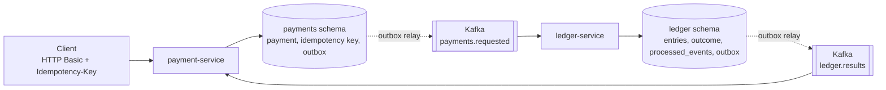

# LedgerFlow

A local, event-driven payments backend (Java 25, Spring Boot, Kafka, PostgreSQL) built to stay financially correct under retries, duplicate messages, crashes and concurrency.

I built this as a solo learning project. A payment service accepts payments over HTTP, a ledger service posts them as balanced double-entry transactions, and Kafka connects the two. It runs on one laptop with Docker Compose; nothing is deployed anywhere.

I built this project with help from AI tools, including Claude Code and Codex.

## Architecture



Both schemas live in one PostgreSQL 17 database, each with its own role; a service can only touch its own schema. A payment moves from `PENDING_LEDGER` to `COMPLETED` or `FAILED` when the ledger's result comes back. A reconciler re-requests payments that stay pending.

## Headline numbers

Every number is from a single laptop (MacBook Air M4, Docker Desktop VM with 10 CPUs and 9.7 GiB) and links to its evidence. Details and conditions are in [docs/RESULTS.md](docs/RESULTS.md).

| Result | Number | Conditions | Source |
|---|---|---|---|
| Automated tests | 84 (payment 39, ledger 25, end-to-end 20), 0 failures | `./mvnw clean verify` on real PostgreSQL 17.11 and Kafka via Testcontainers | [verify evidence](docs/evidence/verify-postgres-phase3b-2026-11-09-b96d66e.txt) |
| Chaos campaign, Kafka 4.0.2 | 27 of 27 runs passed, 0 invariant violations, every crash scenario fired its fault; `kill-ledger-replica` 3 of 3 | 9 scenarios x 3 runs on the default topology, 100 payments/s for 60 s per run; replica scenario on the scaled topology; one campaign | [chaos evidence](docs/evidence/chaos-postgres-phase3b-2026-11-09-b96d66e.txt) |
| Earlier campaign, Kafka 4.0.0 | 27 of 28 recorded runs passed; the 1 failure coincided with a Kafka broker coordinator error | Run in two parts; the failed scenario was re-run. I then pinned Kafka 4.0.2, where the error did not recur in the three broker logs I checked | [chaos evidence](docs/evidence/chaos-postgres-phase3-2026-11-07-4a4e645.txt) |
| Steady load | 840 payments/s achieved in each of 3 runs, 0 failed; POST p99 19.3 to 30.3 ms, request-to-terminal p99 142 to 202 ms | Load credentials hashed at bcrypt cost 4, strict velocity limit raised for the benchmark, tracing sampling 0.1, one session | [steady-1](perf/results/baseline-2026-11-07-5aa8d89/steady-1/summary.md), [steady-2](perf/results/baseline-2026-11-07-5aa8d89/steady-2/summary.md), [steady-3](perf/results/baseline-2026-11-07-5aa8d89/steady-3/summary.md) |
| Steady load, re-run | 840 payments/s in each of 3 runs, 0 failed; POST p99 11.0 to 13.7 ms, request-to-terminal p99 71 to 84 ms | Same settings on Kafka 4.0.2, after a host-state gate; different day and Kafka version, so not a comparison | [summary](perf/results/p3b-2026-11-09-623565f/summary.md) |
| Saturation | Sustained 1,200 payments/s; first saturated step 1,300/s; best achieved rate 1,641.8/s | One ramp (200 to 2,400/s in steps of 100 every 30 s); the best rate was reached while a backlog grew, so it is a peak, not capacity; no request failed | [ramp summary](perf/results/baseline-2026-11-07-5aa8d89/ramp-2/summary.md) |

## Key design decisions

- **Transactional outbox and idempotency.** The payment, its idempotency key and the event commit in one transaction; a relay publishes with `SELECT ... FOR UPDATE SKIP LOCKED`; consumers deduplicate by event id, lock accounts in id order and take a per-payment advisory lock.
- **PostgreSQL over MongoDB** ([ADR 0001](docs/adr/0001-postgres-over-mongodb.md)): constraints carry part of the invariants and the checker is SQL. The ADR compares the two earlier builds; I do not repeat those numbers here.
- **Strict velocity limit** ([ADR 0002](docs/adr/0002-strict-velocity-guard-row.md)): one guard row per payer, locked inside the payment transaction, so the limit is exact under concurrency at the price of serializing one payer's requests.
- **Load credentials at bcrypt cost 4** ([ADR 0003](docs/adr/0003-load-test-credentials.md)): authentication stays on, but hashing at the shipped cost hid every fault's recovery time behind CPU saturation, so load and chaos runs use a cheaper hash.
- **Observability** ([ADR 0004](docs/adr/0004-observability.md)): opt-in Prometheus, Grafana and Jaeger; trace context is stored on the outbox rows so one trace spans both services; scraping uses a management port that is not published, so API authentication is unchanged.
- **Throughput and scaling** ([ADR 0005](docs/adr/0005-ledger-throughput.md), [ADR 0006](docs/adr/0006-horizontal-scaling.md)): in a diagnosis run the ledger consumer fell behind first. Six partitions with six consumer threads gave no clear gain (a negative result), so the default stays at three. An opt-in overlay runs 2 payment and 3 ledger replicas behind HAProxy.

## Quick start

Needs Docker with Compose. The services are built inside Docker, so no local JDK is required.

```sh
docker compose -f infra/docker-compose.yml up --build -d --wait
curl -u alice:alice-local -X POST http://localhost:8081/api/payments -H 'Content-Type: application/json' -H 'Idempotency-Key: demo-1' -d '{"payerAccountId":2,"payeeAccountId":5,"amountMinor":1500,"currency":"USD"}'
curl -u alice:alice-local http://localhost:8081/api/payments/<id from the previous response>
```

The second command sends 15.00 USD (amounts are in cents) from seeded customer account 2 to merchant account 5; repeating it with the same key returns the stored response. The third shows `COMPLETED` once the ledger has posted. Stop with `docker compose -f infra/docker-compose.yml down`. To run the end-to-end scenarios: `bash scripts/smoke.sh`.

## How it was verified

- **Tests:** the 84 tests above, including end-to-end tests that start both real services and tests for ordering, concurrency, crash recovery and the velocity limit.
- **Invariants I1 to I6**, checked in SQL ([`chaos/verify_invariants.sql`](chaos/verify_invariants.sql)) after every chaos and smoke run: ledger balances and sums to zero; each payment is posted at most once with its own amount and accounts; every accepted payment reaches a terminal state matching the ledger; no negative customer balance; cached balances equal the sum of entries; one idempotency key per payment.
- **Chaos runner** ([`chaos/run_chaos.sh`](chaos/run_chaos.sh)): kill a service, pause PostgreSQL, restart Kafka, replay events, hammer one account, and three crash points (before the payment outbox commit, between publishing and marking, after the ledger commit). A crash scenario whose fault never fired is reported as not passed.
- **Smoke:** 7 of 7 scenarios on a fresh Compose project ([evidence](docs/evidence/smoke-postgres-phase3b-2026-11-09-b96d66e.txt)).

## Limits

- One laptop, one Kafka broker, one PostgreSQL node, no failover. Performance numbers are single runs and depend on the settings in the table.
- Authentication is HTTP Basic with in-memory demo credentials. At the shipped bcrypt cost of 10, one run offered 100 payments/s and achieved 54.0/s on this machine ([ADR 0003](docs/adr/0003-load-test-credentials.md)), which is why load runs use cost 4.
- The strict velocity limit serializes requests of one payer, so a hot payer limits itself.
- Not measured: whether the database commit path (`synchronous_commit`) is the shared limit, and the throughput of the scaled topology ([ADR 0005](docs/adr/0005-ledger-throughput.md), [ADR 0006](docs/adr/0006-horizontal-scaling.md)).
- Not production-ready. A real deployment would still need TLS and a real identity provider, managed secrets, replicated Kafka and PostgreSQL with backups and tested failover, alerting tied to service-level objectives, and capacity measured on real hardware.

## More

[docs/RESULTS.md](docs/RESULTS.md) (all measurements) · [docs/adr/](docs/adr/) · [docs/ROADMAP.md](docs/ROADMAP.md) · [perf/README.md](perf/README.md) (how to reproduce the load runs) · [release notes](docs/RELEASE_NOTES_v2.0.0.md). The MongoDB build is tag `v1.3.0-mongodb`.
